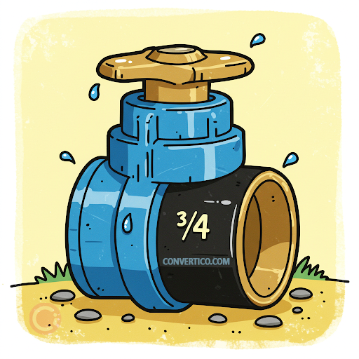

# BMP-watermark-applicator
A program which applies a watermark for BMP images.

## Status badge
[](https://github.com/ITMO-IS-M3101-fight-club/BMP-watermark-applicator/actions/workflows/workflow.yml)


## How to run tests

```bash
cmake -S . -B build
cmake --build build
./build/watermark_test.exe
```
Then check the result.bmp


Additionally, you can run tests with already added images. Run at the root directory of the project:
```bash
cmake -S . -B build
cmake --build build

./build/bin/watermark -o tests/bmp-large-2000px.bmp -w tests/blue-bmp-24-bit.bmp -r tests/result_big_images.bmp -t 0.4
```
The result image will be at "tests/result_big_images.bmp" (an image with a dragon).

## How to run 
```bash
cmake -S . -B build
cmake --build build

./build/bin/watermark -o [PATH_TO_YOUR_ORIGINAL_FILE_FROM_PROJECT_DIR] -w [PATH_TO_YOUR_WATERMARK_FILE_FROM_PROJECT_DIR] -r [PATH_TO_THE_RESULT_FILE_FROM_PROJECT_DIR] -t [COEFFICIENT_OF_TRANSPARENCY]
```
<i>NOTE: COEFFICIENT_OF_TRANSPARENCY should be in tha range from 0.0 to 1.0</i>

## By what rule does the watermark apply?
We used simple algorithm: for each color (RGB), we change the density of it in the original to the (1.0 - alpha), and add the new one, multiplied by alpha, where alpha is a transparency coefficient.

Here is a piece of code whick does that: 
```cpp
original[color] * (1.0 - alpha) + mark[color] * alpha
```

## Team contribution
* Ратибор Винокуров — общий класс ImageBmp, чтение, сохранение файлов

* Беловолов Тимофей — наложение вотермарки, базовые тесты 

* Афинагентов Святослав — финальная сборка, документация, дополнительные тесты, рефакторинг, настройка github репозитория и workflow

## Чему научились? 
Работать в команде (с использванием системы контроля версий), писать читаемый и поддерживаемый код

## Наглядные примеры работы программы 
Скрипт запуска: 
```bash
cmake -S . -B build
cmake --build build

./build/bin/watermark -o tests/bmp-large-2000px.bmp -w tests/blue-bmp-24-bit.bmp -r tests/result_big_images.bmp -t 0.6
```
### Исходное изображение

<p align="center">
  
</p>

### Вотермарка

<p align="center">
  
</p>

### Итоговое изображение

<p align="center">
  
</p>